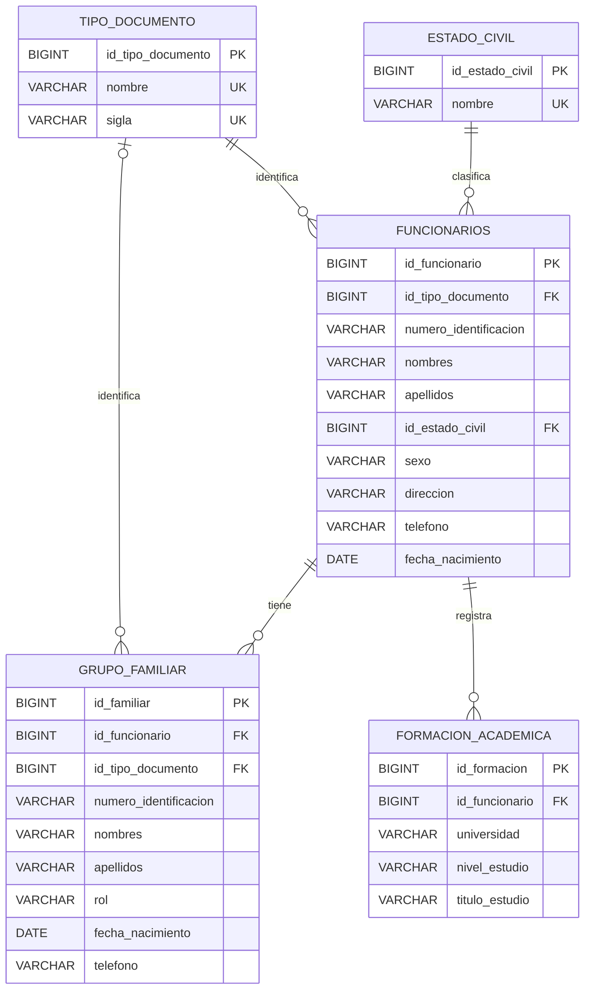

# Modelo relacional — Sistema de Recursos Humanos

La base de datos `rrhh_iudigital` se organiza en cinco tablas: dos catálogos (`tipo_documento` y `estado_civil`), la tabla central `funcionarios` y dos tablas dependientes (`grupo_familiar` y `formacion_academica`).

## Diagrama entidad-relación

## Esquema relacional

- **TIPO_DOCUMENTO**(**id_tipo_documento**, nombre, sigla). Catálogo de documentos de identificación; nombre y sigla son únicos.
- **ESTADO_CIVIL**(**id_estado_civil**, nombre). Catálogo de estados civiles; el nombre es único.
- **FUNCIONARIOS**(**id_funcionario**, id_tipo_documento FK, numero_identificacion, nombres, apellidos, id_estado_civil FK, sexo, direccion, telefono, fecha_nacimiento). La combinación `(id_tipo_documento, numero_identificacion)` es única.
- **GRUPO_FAMILIAR**(**id_familiar**, id_funcionario FK, id_tipo_documento FK nullable, numero_identificacion nullable, nombres, apellidos, rol, fecha_nacimiento nullable, telefono nullable). Si se registra el documento de un familiar, se deben indicar tanto el tipo como el número; ambos pueden quedar vacíos cuando el familiar no tiene documento registrado.
- **FORMACION_ACADEMICA**(**id_formacion**, id_funcionario FK, universidad, nivel_estudio, titulo_estudio). Se impide repetir para un funcionario la misma universidad, nivel y título.

## Cardinalidades

1. Un tipo de documento puede estar asociado a muchos funcionarios (**1:N**). Cada funcionario debe tener un tipo de documento.
2. Un estado civil puede estar asociado a muchos funcionarios (**1:N**). Cada funcionario debe tener un estado civil.
3. Un funcionario puede tener cero o muchos integrantes en su grupo familiar (**1:N**). Cada integrante se relaciona con un funcionario.
4. Un funcionario puede registrar cero o muchas formaciones académicas (**1:N**). Cada formación pertenece a un funcionario.
5. Un tipo de documento puede aparecer en muchos integrantes del grupo familiar (**1:N**); la relación es opcional para el integrante.

## Restricciones y reglas

- Las claves primarias son autoincrementales y las claves foráneas mantienen la integridad referencial.
- Las relaciones desde funcionarios hacia sus familiares y su formación académica usan `ON DELETE CASCADE`: eliminar un funcionario elimina esos registros dependientes. La aplicación pide confirmación antes de hacerlo.
- Los catálogos usan `ON DELETE RESTRICT`: no puede borrarse un tipo de documento o estado civil mientras existan registros que lo utilicen.
- Los documentos y teléfonos se almacenan como `VARCHAR`, no como números, para preservar ceros iniciales y posibles símbolos.
- `sexo` y `rol` se guardan como texto porque el caso de estudio no solicita catálogos separados para esos campos.
- `formacion_academica` conserva `nivel_estudio` como texto con opciones controladas desde el formulario; se puede convertir en catálogo si los requisitos del docente lo necesitan.

## Normalización

Las tablas `tipo_documento` y `estado_civil` evitan repetir el nombre de esas categorías por cada funcionario. Las tablas `grupo_familiar` y `formacion_academica` permiten registrar varios familiares y varios estudios por funcionario, manteniendo los datos en tablas relacionadas y evitando columnas repetidas para cada familiar o título.
